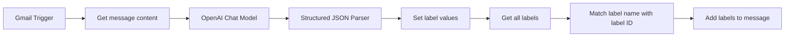
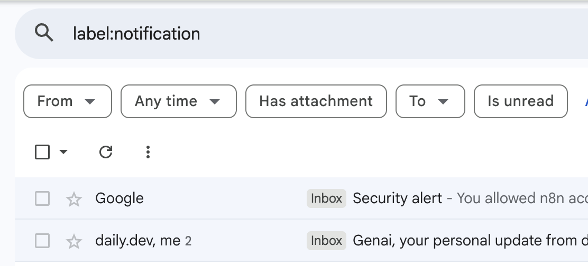
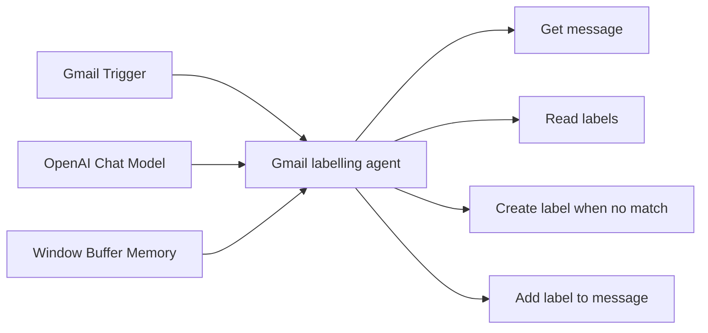
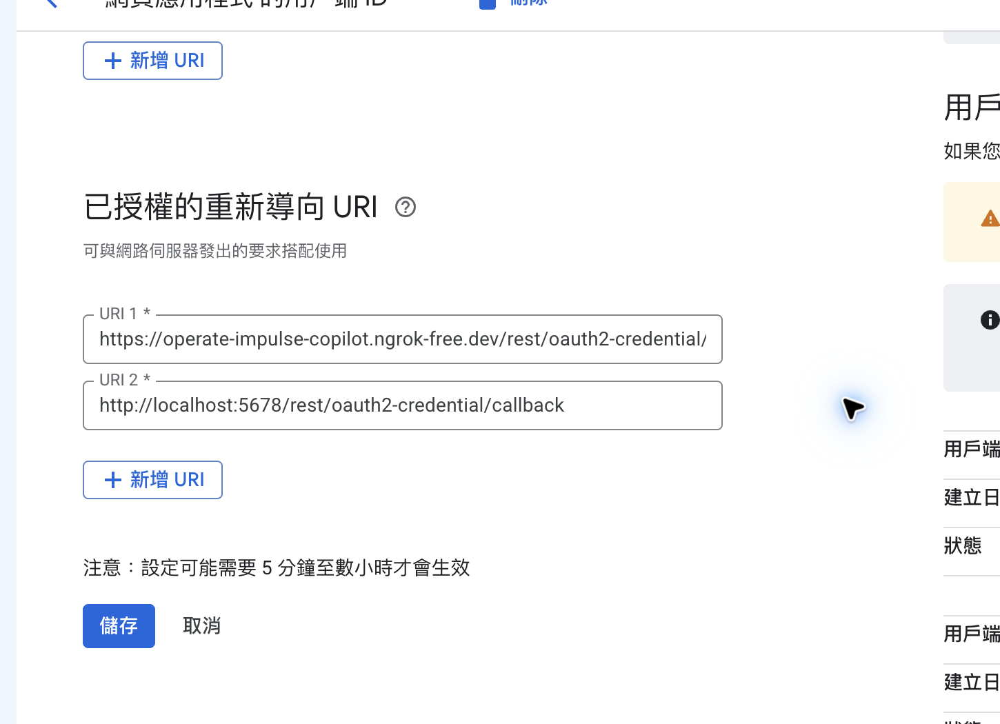
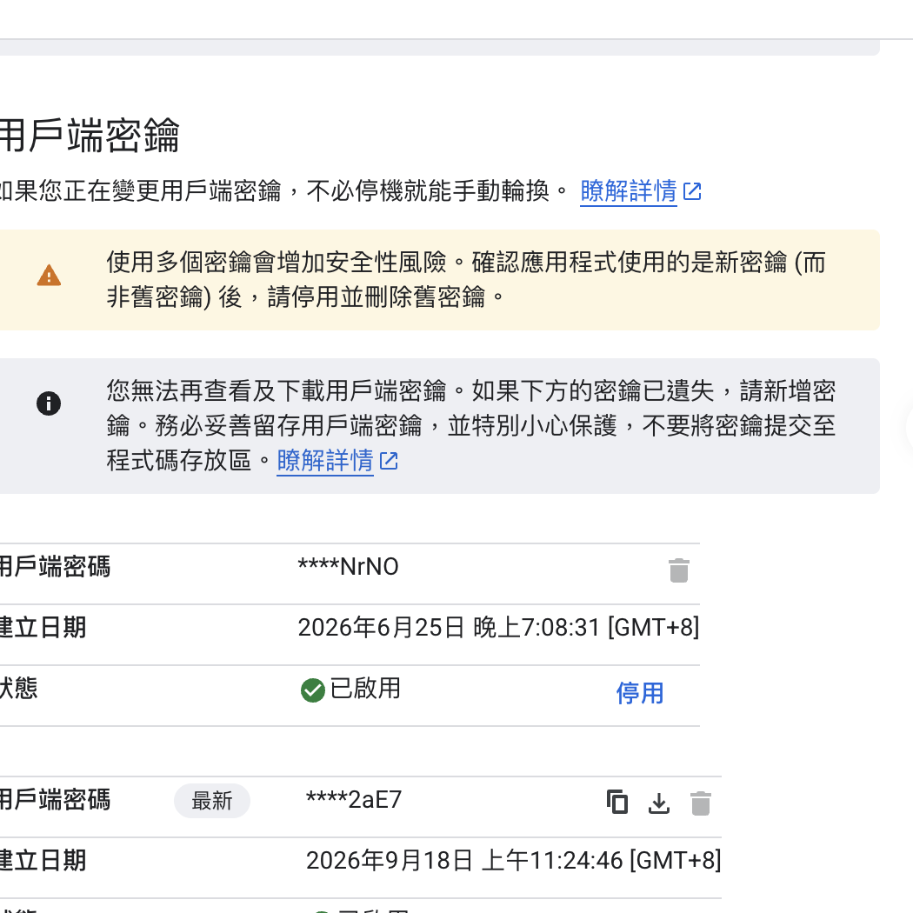

# 官方範本延伸練習：Gmail AI 自動分類

本教材將兩個官方／社群工作流轉為可在課堂操作的練習。核心原則是先以測試信件驗證「讀取 → AI 分類 → 標籤對照」，確認結果正確後才允許節點真的修改 Gmail。

## 使用的範本與練習檔

| 範本 | 教材內檔案 | 難度 | 特徵 |
| --- | --- | --- | --- |
| [Auto-label incoming Gmail messages with AI nodes](https://n8n.io/workflows/1496-auto-label-incoming-gmail-messages-with-ai-nodes/) | `案例範本/官方JSON/Auto-label incoming Gmail messages with AI nodes.json` | 基礎 | 固定標籤集合、結構化 JSON 輸出、學生容易追蹤每個節點。 |
| [Basic Automatic Gmail Email Labelling with OpenAI and Gmail API](https://n8n.io/workflows/2740-basic-automatic-gmail-email-labelling-with-openai-and-gmail-api/) | `案例範本/官方JSON/Basic Automatic Gmail Email Labelling with OpenAI and Gmail API.json` | 進階 | AI Agent 可讀取既有標籤、套用標籤，必要時建立新標籤。 |

> 不要把任何範本中的 Gmail Trigger 直接啟用在正式信箱。先以測試標籤、測試信件與手動 Execute workflow 驗證。

## 練習一：固定標籤的 AI 自動分類

這是本週先做的版本，對應 `01-使用AI節點自動標記Gmail郵件`。工作流有一組明確、可控的標籤，例如 `Partnership`、`Inquiry`、`Notification`。AI 只能從這些選項選擇，因此比自動建立標籤安全。



### 節點的教學重點

1. **Gmail Trigger**：取得新信件的 message ID。課堂測試時，按節點內的 **Fetch Test Event**，不要立即 Activate。
2. **Get message content**：用 message ID 取回主旨與內文，讓 AI 有足夠的分類依據。
3. **OpenAI Chat + JSON Parser**：提示詞要求 AI 只回傳預先定義的標籤名稱；Parser 將回覆限制為機器可讀 JSON，避免後續節點拿到自由文字而失敗。
4. **Get all labels → Match**：Gmail 需要的是 label ID，不是人類可讀名稱，因此要先讀取標籤清單並比對。
5. **Add labels to message**：最後才真的更新 Gmail。這個節點成功不代表信件被搬走；它只是新增標籤。

### 實作步驟

1. 匯入 `案例範本/官方JSON/Auto-label incoming Gmail messages with AI nodes.json`。
2. 對所有 Gmail 節點選相同的 **Gmail OAuth2 API** credential；OpenAI Chat 節點選自己的 OpenAI credential。
3. 在 Gmail 建立課堂用標籤，例如 `Partnership`、`Inquiry`、`Notification`；同時更新 Agent 提示詞與 JSON schema，三者的名稱必須完全一致。
4. 寄一封內容明確的測試信，例如「系統安全通知」或「合作提案」。
5. 在工作流按 **Execute workflow**，等候每個節點出現 Success。
6. 最後到 Gmail 開啟同一封信，確認標籤是否存在；不要只以 n8n 成功訊息作為證據。

### 實際執行紀錄：已驗證的案例

本教材已以一封 Google 的「Security alert」測試：工作流成功跑完，OpenAI 使用結構化輸出判斷為 `Notification`，再由 Gmail 節點加入該標籤。

| 驗證項目 | 結果 |
| --- | --- |
| 觸發與讀取 | 成功取得 1 封信件及完整內容。 |
| AI 分類 | `Notification`。 |
| 標籤對照 | 由 Gmail 標籤清單找到 `Notification` 對應的 label ID。 |
| Gmail 寫入 | `Add labels to message` 成功。 |
| Gmail 端複查 | 信件仍在 Inbox、仍是 Unread，且已附加 `Notification`；未刪除、未封存、未移動。 |

下圖為 Gmail 端的實際複查畫面。搜尋列顯示 `label:notification`，代表目前正在檢視已套用 `Notification` 標籤的信件。為保護隱私，畫面僅保留驗證所需的搜尋與篩選區域，未放入帳號、信件主旨、寄件者或內文。



學生完成第 6 步後，也應以相同方式在 Gmail 搜尋 `label:你的標籤名稱`；能看到結果才算完成端到端驗證。

### 執行結果怎麼讀

執行面板應依序看到：

```text
Gmail trigger                 Success
Get message content           Success
Assign labels for message     Success
JSON Parser                   Success
Get all labels                Success
Merge / Aggregate label IDs   Success
Add labels to message         Success
```

若 `Add labels to message` 的 Output 中，`labelIds` 同時出現原有的 `INBOX`、`UNREAD` 與新 label ID，表示動作是「新增」標籤，並沒有移除既有狀態。實際結果仍應回到 Gmail 手動複查。

## 練習二：使用 OpenAI 與 Gmail API 的 Agent 標記

本練習使用 `Basic Automatic Gmail Email Labelling with OpenAI and Gmail API.json`。相較於練習一，它不使用固定的標籤對照流程，而是讓 **Gmail labelling agent** 依需要呼叫工具。



### Agent 可做與不可做的事

| 工具 | 作用 | 風險控制 |
| --- | --- | --- |
| Gmail - get message | 讀取單封信的資料 | 讀取，不改變 Gmail。 |
| Gmail - read labels | 取得既有標籤清單 | 讀取，不改變 Gmail。 |
| Gmail - create label | 找不到合適類別時建立標籤 | 會改變 Gmail；先限制測試信箱。 |
| Gmail - add label to message | 為信件加上分類標籤 | 會改變 Gmail；完成後到 Gmail 複查。 |

### 課堂操作流程

1. 匯入 `案例範本/官方JSON/Basic Automatic Gmail Email Labelling with OpenAI and Gmail API.json`。
2. 為 Gmail Trigger、四個 Gmail Tool 節點選同一組 Gmail OAuth2 credential；為 OpenAI Chat Model 選 OpenAI credential。
3. 先閱讀 **Gmail labelling agent** 的 system prompt。它會：讀取信件、比對既有標籤、優先重用標籤；只有沒有合適標籤時才建立新標籤。
4. 初次操作前，將 prompt 改為：`只可使用既有標籤；找不到合適標籤時回覆「需要人工分類」，不可建立新標籤。` 這是安全模式。
5. 以一封測試信按 **Execute workflow**；在執行面板展開 Agent，查看它依序呼叫了哪些 Gmail Tool。
6. 確認分類準確後，才移除安全模式限制，允許 `Gmail - create label`。
7. 重新以另一封測試信執行，最後在 Gmail 查核信件位置、既有標籤與新增標籤。

## Google Cloud OAuth 設定截圖

兩個練習都需要同一組 Gmail OAuth2 credential。Google Cloud Console 的完整申請與設定步驟見 [API與憑證申請指南](API與憑證申請指南.md)。



截圖說明：在 **Google Auth Platform > 用戶端 > Web application** 的「已授權的重新導向 URI」中，新增 n8n Credential 視窗顯示的完整 Callback URL；本機預設為 `http://localhost:5678/rest/oauth2-credential/callback`。儲存後再回 n8n 點 **Sign in with Google**。



截圖說明：Client Secret 只應貼入 n8n Credential，不應出現在 JSON、Markdown、作業截圖、Git commit 或聊天室。若遺失，建立新 secret 後在 n8n 更新，再停用舊 secret。

## 常見失敗與除錯順序

1. **Gmail Trigger 沒資料**：先在節點內執行 Fetch Test Event，確認 Gmail credential 已連線與有新測試信。
2. **OpenAI 節點失敗**：確認 API key、project billing／額度及模型名稱；用短文本先測。
3. **AI 回傳的標籤不存在**：固定標籤版要同時修改 Prompt、JSON schema 和 Gmail 實際標籤；Agent 版則先採安全模式避免自動建標籤。
4. **Gmail 節點顯示成功但找不到結果**：從 Execution Output 找 message ID，回 Gmail 搜尋該信，確認是加入標籤、移出收件匣，還是沒有權限寫入。
5. **不確定是否安全**：先停用 `create label` 與 `add label`，只保留讀取與 AI 分類，讓學生先交出分類結果再進入寫入階段。

### `Invalid label: Notification` 的修正

這是 Agent 範本常見的欄位型別錯誤。`Gmail - add label to message` 的 `labelIds` 需要 Gmail 的內部 label ID，例如 `Label_123456789`，不是畫面上顯示的標籤名稱 `Notification`。此節點版本也不接受 JSON 陣列字串；修正後的教材範本會先呼叫 `Gmail - read labels`，再把回傳資料中的單一 `id` 值傳給 `gmail_label_id`。

若自行改寫 Agent，請在 system prompt 加入：「套用標籤前必須讀取標籤清單；只能傳入單一 `id` 值，不能傳標籤名稱或 JSON 陣列。」執行面板中的 Input 應顯示 `gmail_label_id: Label_...`。

## 學生交付成果

- [ ] 一張 n8n 成功執行面板截圖（遮蔽個人信件內容與 email）。
- [ ] 一張 Gmail 信件畫面，清楚顯示新加入的標籤。
- [ ] 說明該信件為何被分類到這個標籤。
- [ ] 說明本次有無建立新標籤、移出 Inbox 或變更已讀狀態。
- [ ] 確認作業未包含 API key、Client Secret、OAuth JSON 或完整私人信件內容。
