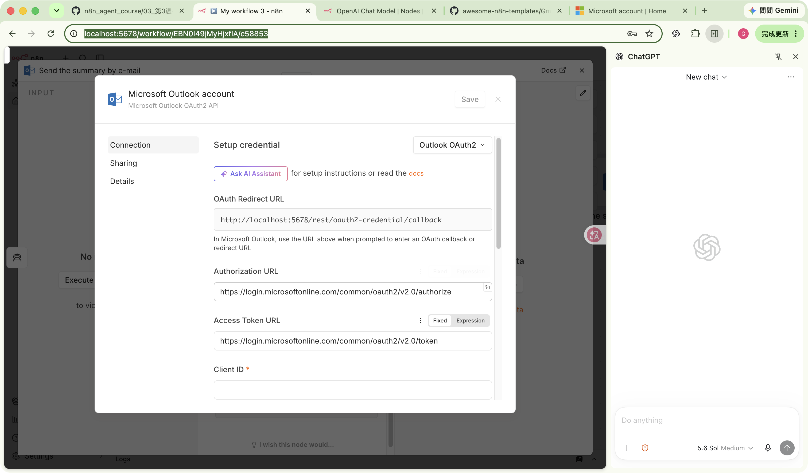
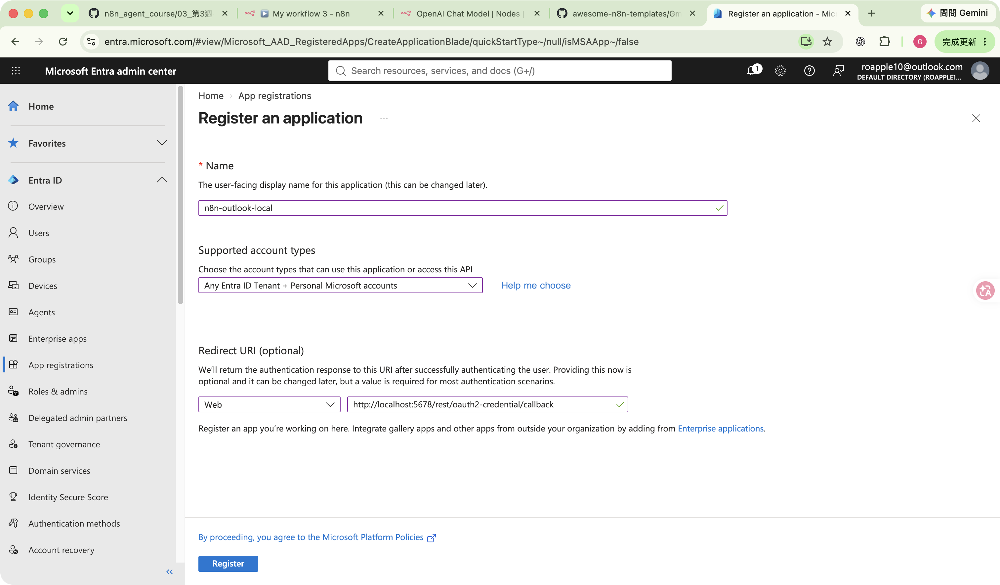
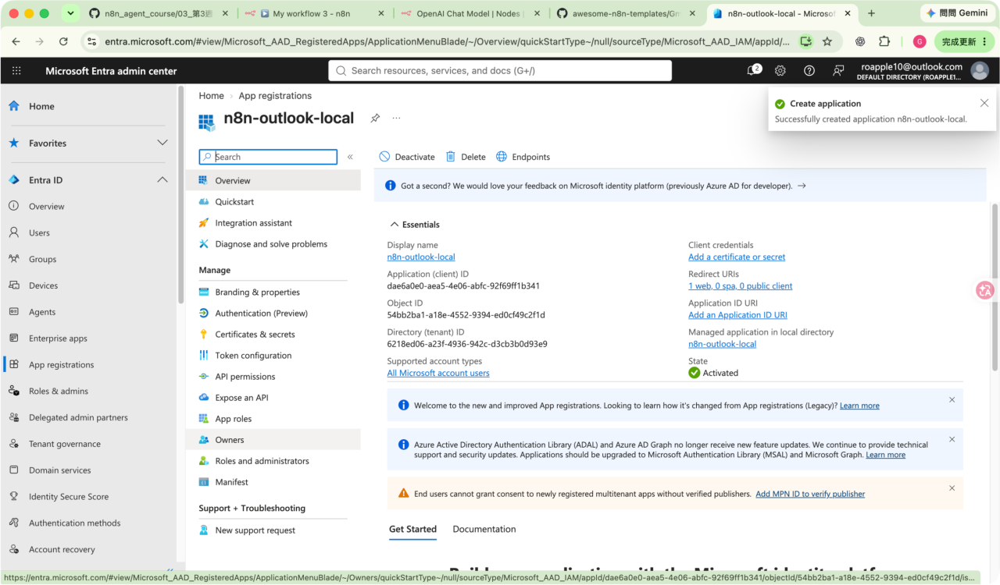
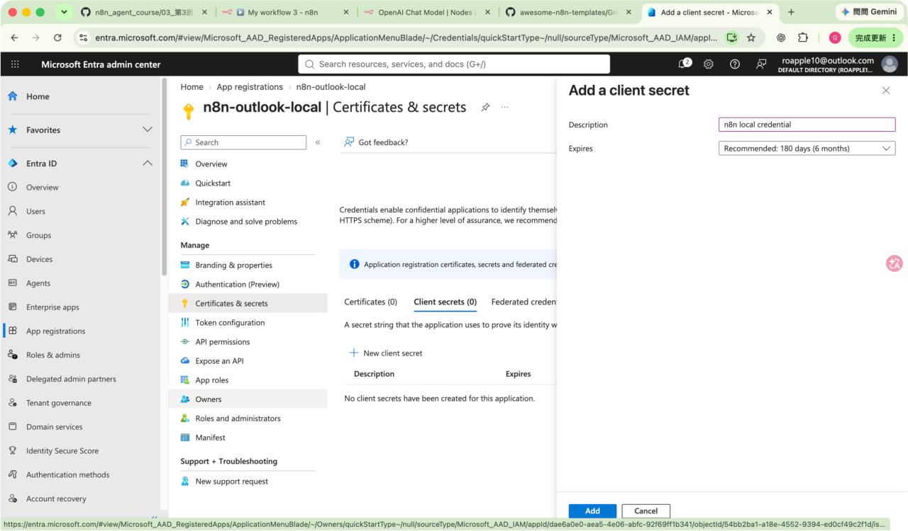
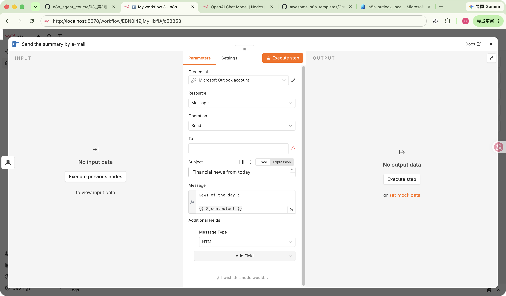

# 第 3 週：Microsoft Outlook／Graph OAuth 與 HTTP Request

## 流程概述與前置準備

本教學示範如何從零開始，透過 Microsoft Entra ID 建立應用程式註冊（App registration）、取得 Client ID 與 Client Secret，並在 n8n 中完成 Microsoft Outlook OAuth2 憑證授權與連線。

- **支援帳號**：個人 Microsoft 帳號（如 `@outlook.com`、`@hotmail.com`）或自有管理權限之組織帳號。
- **金鑰期限**：建議建立 180 天（6 個月）的 Client Secret，到期前需進行輪替更新。
- **安全原則**：Client Secret 的 **Value** 只在建立當下顯示一次，切勿寫入 Markdown、Git、節點參數或公開截圖中。

> 安全原則：Client Secret 的 **Value** 只在建立當下顯示一次，不可寫入 Markdown、Git、節點參數或截圖。本文截圖刻意避開密鑰值。

## 1. 先從 n8n 取得 Redirect URL

1. 開啟工作流程的 Microsoft Outlook 節點。
2. 在 **Credential** 建立或編輯 `Microsoft Outlook OAuth2 API` credential。
3. 複製畫面上的 **OAuth Redirect URL**。本機 n8n 顯示的值為：

   ```text
   http://localhost:5678/rest/oauth2-credential/callback
   ```



Redirect URI 必須逐字相同，包含 `http`/`https`、主機、連接埠、路徑與尾端斜線。

## 2. 登入 Microsoft Entra admin center 並確認目錄

1. 開啟並登入 [Microsoft Entra admin center](https://entra.microsoft.com/)。
2. 若您的帳號加入多個目錄，可點右上角帳號圖示，選擇 **Switch directory**（切換目錄）。
3. 切換到個人的 **Default Directory**（預設目錄），確保後續應用程式註冊由個人直接管理。
4. 再次打開帳號選單，確認畫面顯示 `under Default Directory`。

若帳號同時加入多個組織，這一步能確保 App registration 實際建立在正確的目錄中。

## 3. 從零建立 App registration

1. 進入 **Entra ID > App registrations > New registration**。
2. **Name** 填入 `n8n-outlook-local`。
3. **Supported account types** 選擇：

   **Accounts in any organizational directory (Any Microsoft Entra ID tenant - Multitenant) and personal Microsoft accounts**

4. **Redirect URI** 的平台選擇 **Web**。
5. 貼上 n8n 顯示的 Redirect URL：

   ```text
   http://localhost:5678/rest/oauth2-credential/callback
   ```

6. 按 **Register**。



## 4. 複製 Application (client) ID

建立完成後會進入 **Overview**：

1. 確認 **Display name** 為 `n8n-outlook-local`。
2. 確認 **Supported account types** 為所有 Microsoft 帳號使用者。
3. 複製 **Application (client) ID**；稍後貼到 n8n 的 **Client ID**。
4. **Object ID** 不是 Client ID，不要貼錯。
5. 這個 n8n credential 使用 `/common/` OAuth endpoint，因此不需另填 Tenant ID。



Client ID 與 Tenant ID 是識別字，不是密碼；但建議仍避免在公開文件中重複貼上真實值。

## 5. 建立 Client Secret

1. 進入 **Certificates & secrets > Client secrets**。
2. 按 **New client secret**。
3. **Description** 填入 `n8n local credential`。
4. **Expires** 選擇 Microsoft 建議的 **180 days (6 months)**。
5. 按 **Add**。
6. 在沒有離開頁面前，立即複製新增列的 **Value**。不要複製 **Secret ID**。



> 密鑰到期後，n8n 會無法更新 access token。到期前應建立新密鑰、更新 n8n credential、重新連線，然後再刪除舊密鑰。

## 6. 填入 n8n credential 並授權

1. 回到 n8n `Microsoft Outlook account` credential。
2. **Authorization URL** 保持：

   ```text
   https://login.microsoftonline.com/common/oauth2/v2.0/authorize
   ```

3. **Access Token URL** 保持：

   ```text
   https://login.microsoftonline.com/common/oauth2/v2.0/token
   ```

4. **Client ID** 貼上 Overview 的 **Application (client) ID**。
5. **Authentication** 保持 **Client Secret**。
6. **Client Secret** 貼上剛剛複製的 **Value**。
7. **Microsoft Graph API Base URL** 保持 **Global (`https://graph.microsoft.com`)**。
8. **Custom Scopes** 保持關閉；**Use Shared Mailbox** 保持關閉。
9. 按 **Save**，再按 **Connect**。
10. Microsoft 要求登入時，請輸入欲連線的 Microsoft 帳號並完成驗證。
11. 在 `Let this app access your info?` 畫面檢查應用名稱為 `n8n-outlook-local`，然後按 **Accept**。
12. OAuth 快顯視窗自動關閉，回到 n8n 後即表示授權回呼完成。

## 7. Microsoft Graph 權限說明

n8n Outlook credential 在 **Custom Scopes 關閉**時，會於 Connect 過程動態要求以下 delegated scopes，不需事先在 **API permissions** 手動逐項新增：

```text
openid
offline_access
Contacts.Read
Contacts.ReadWrite
Calendars.Read
Calendars.Read.Shared
Calendars.ReadWrite
Mail.ReadWrite
Mail.ReadWrite.Shared
Mail.Send
Mail.Send.Shared
MailboxSettings.Read
```

這是 n8n Outlook credential 的預設權限集，因此 Microsoft 同意畫面會包含聯絡人、行事曆、郵件讀寫與寄信權限。若只做郵件讀取或草稿，可開啟 **Custom Scopes** 改成最小權限，但後續使用其他 Outlook 功能時必須再補權限並重新授權。

## 8. 連線驗證與節點完整性設定

完成 OAuth 授權後，請回到工作流程進行連線狀態檢查與節點參數補完：

1. **確認憑證連線狀態**：
   - 開啟工作流程中的 Outlook 節點（例如「Send the summary by e-mail」）。
   - 在 **Credential** 下方確認已選取 `Microsoft Outlook account`，點選右側的鉛筆圖示進入憑證設定。
   - 確認畫面上方顯示綠色的 **Account connected**（代表 OAuth2 連線已生效）。確認後關閉憑證彈窗。

2. **修復節點警示（填寫 To 收件人欄位）**：
   - 剛匯入的官方範本中，Outlook 節點通常預設為 **Message > Send**，但 `To`（收件人）欄位為空值，此時該欄位會顯示紅色警告標記（Parameter has issues）。
   - 請在 **To** 欄位填入預計接收郵件的測試信箱（例如您自己的 Outlook 信箱：`your-account@outlook.com`），填入後警告圖示即會自動消除。

3. **存檔與畫布驗證**：
   - 點選右上角的關閉按鈕（`✕`）關閉節點設定抽屜。
   - 使用快捷鍵儲存工作流程（Mac：`Cmd + S`，Windows：`Ctrl + S`）或點選畫面上的 **Save**。
   - 檢查畫布上的所有節點，確認節點右上角已無任何紅色錯誤或驚嘆號標記，整條流程恢復正常待命狀態。



> **安全寄信提醒**：不要為了測試 credential 直接盲目點擊 **Execute step**；若要安全測試，建議填入自己的測試信箱，或複製一個測試節點改用唯讀操作（例如取得郵件清單）或先建立草稿（Draft），確認內容排版無誤後才啟用正式寄信排程。

## 9. 常見錯誤與處理

| 現象 | 檢查重點 |
| --- | --- |
| `redirect_uri_mismatch` | Entra 的 Web Redirect URI 必須與 n8n 顯示值完全相同。 |
| `invalid_client` 或密鑰錯誤 | 確認貼上的是 Client Secret **Value**，不是 Secret ID；同時檢查是否已過期。 |
| 授權畫面出現非目標帳號 | 取消授權，登出該帳號或在 Microsoft 畫面選擇正確帳號重新登入。 |
| 需要管理員同意 | 組織租用戶可能禁止使用者 consent；由管理員核准，或改用自己有管理權的測試 tenant。 |
| 連線後仍無法使用某功能 | 檢查該功能需要的 Graph scope；更改 Custom Scopes 後需重新 Connect。 |
| n8n 不是在同一台電腦 | `localhost` 只指向瀏覽器所在主機；改用實際 n8n 網址，並在 Entra 同步更新 Redirect URI。 |

## HTTP Request 憑證安全原則

- 公開 API 可直接呼叫；需要 API key、Bearer token 或 Basic Auth 時，使用 n8n credential 保管。
- 不要把 token 或 API key 直接寫在 Header、Code node、Set node、workflow JSON 或 Git 版本庫。
- 儘量限制 **Allowed HTTP Request Domains**，不要在生產環境長期使用 `All`。
- 使用最小權限、短有效期、可輪替的憑證，並為密鑰到期建立提醒。

## 官方參考

- [n8n：Microsoft credentials](https://docs.n8n.io/integrations/builtin/credentials/microsoft/)
- [Microsoft Graph：Register an application](https://learn.microsoft.com/en-us/graph/auth-register-app-v2)
- [Microsoft Graph：Authentication and authorization basics](https://learn.microsoft.com/en-us/graph/auth/auth-concepts)
- [Microsoft identity platform：Redirect URI restrictions and limitations](https://learn.microsoft.com/en-us/entra/identity-platform/reply-url)
