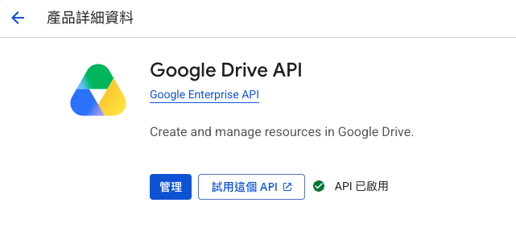
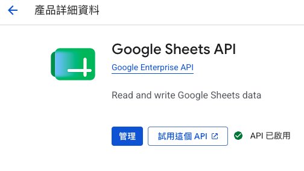
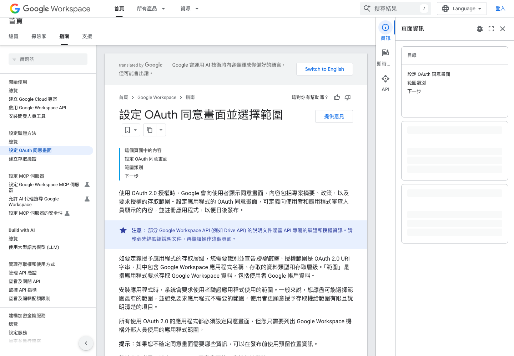
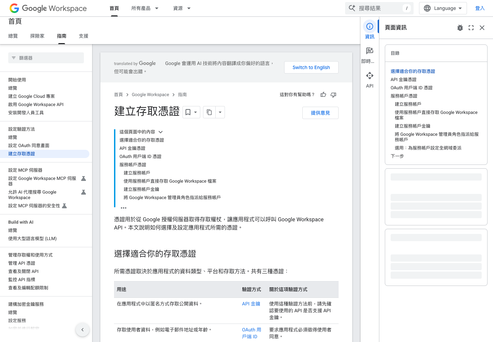
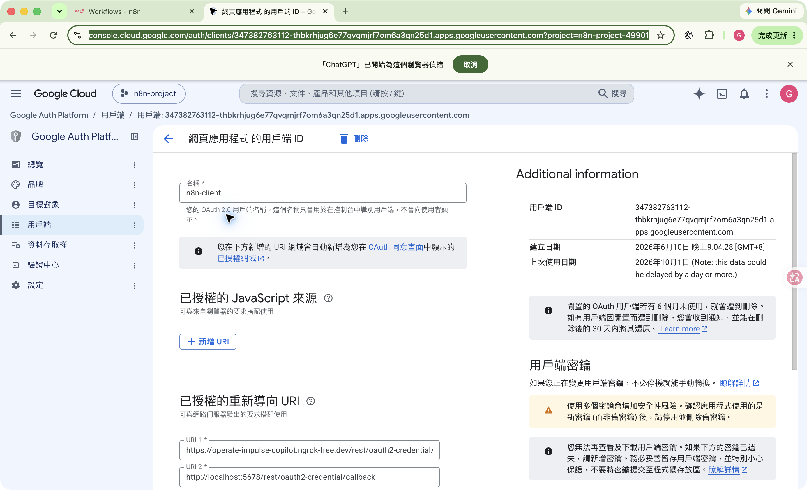
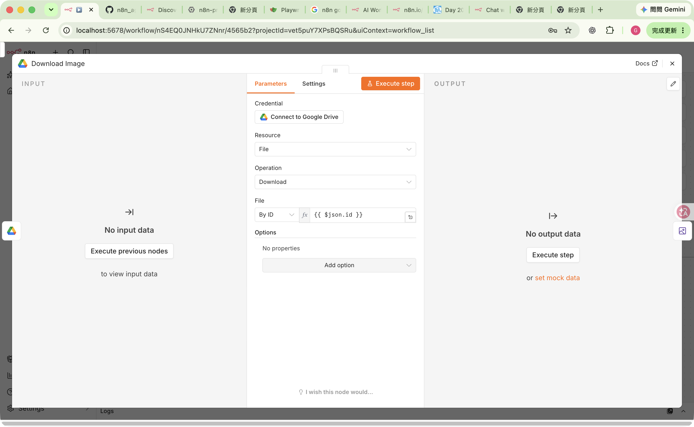
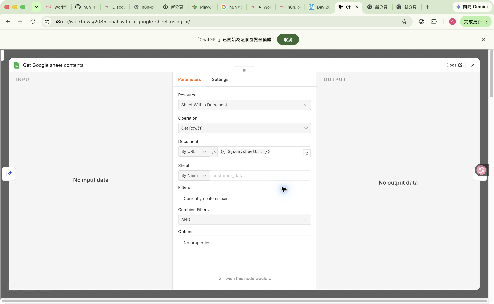
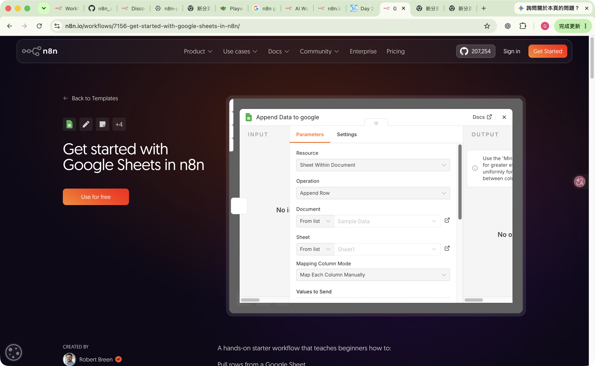

# 第 4 週：Google Drive 與 Google Sheets API／OAuth 憑證申請指南


>
> **前置基礎：** 本章延續「[02_第2週-Gmail與OpenAI/API與憑證申請指南.md](../02_第2週-Gmail與OpenAI/API與憑證申請指南.md)」的 Google Cloud 專案、OAuth 同意畫面與 Web application 用戶端
>
> **完成目標：** Drive 列出 1 個檔案、Sheets 讀取資料，並新增 1 列測試資料
> **更新日期：** 2026-10-15

---

## 一、先選擇你的路線

| 你的情況 | 請走的路線 | 需要做什麼 |
|---|---|---|
| 第 2 週 Gmail OAuth2 已成功，而且仍使用同一個 n8n 網址 | **快速路線** | 沿用專案、OAuth 同意畫面、Test users 與 Web client；只啟用 Drive／Sheets API，再建立 n8n 憑證 |
| 第 2 週未完成，或換了 n8n 網址 | **完整路線** | 從 Google Cloud 專案、OAuth 同意畫面、Web client 開始檢查 |


> [!IMPORTANT]
> 不要因為進入第 4 週就再建一個新專案。若第 2 週的專案是你自己的、n8n Redirect URL 也沒變，直接沿用最容易管理。

---

## 二、先建立安全的測試資料

1. 在 Google Drive 新增資料夾，命名為 `n8n-course-test`。
2. 在資料夾內新增 Google 試算表，同樣命名為 `n8n-course-test`。
3. 第一列輸入欄位名稱：

| A | B | C |
|---|---|---|
| `name` | `email` | `status` |

4. 第二列輸入測試資料：

| A | B | C |
|---|---|---|
| `Test Student` | `student@example.com` | `ready` |

> [!WARNING]
> 課堂練習不要使用正式作業、客戶資料或共用資料夾。測試資料夾先只分享給自己。

---

## 第 2 週已完成者：快速路線

### 4-1 確認可沿用的項目

請打開第 2 週 Gmail OAuth2 已成功的 Google Cloud 專案，確認：

- 頂端專案名稱是第 2 週的課程專案。
- **Google Auth Platform > Branding** 已有應用名稱和支援信箱。
- **Audience** 中的 External／Internal 設定正確。
- External + Testing 時，實際授權帳號已在 **Test users**。
- **Clients** 中已有 Web application 用戶端。
- 你現在使用的 n8n OAuth Redirect URL 與第 2 週相同。

若以上都正確，不需要再建一個 OAuth 同意畫面或 Web client。

### 4-2 在原專案啟用兩個 API

1. 開啟 [Google Cloud API Library](https://console.cloud.google.com/apis/library)。
2. 先確認頁面頂端是第 2 週的專案。
3. 搜尋 `Google Drive API`，點進去後按 **Enable／啟用**。
4. 回到 API Library，搜尋 `Google Sheets API`，按 **Enable／啟用**。
5. 進入 **APIs & Services > Enabled APIs & services**，確認兩個 API 都在清單中。




### 4-3 沿用 Client ID／Secret

1. 在 Google Auth Platform > Clients 開啟第 2 週建立的 Web application client。
2. 檢查 **Authorized redirect URIs** 是否包含目前 n8n 顯示的 OAuth Redirect URL。
3. 在 n8n 建立 Google Drive OAuth2 與 Google Sheets OAuth2 憑證，依節點畫面選擇 **Custom OAuth2**。
4. 填入同一組 Client ID／Client Secret，再分別按 **Sign in with Google**。

> [!TIP]
> 可沿用的是 Google Cloud 的 Web client。在 n8n 中，Drive 與 Sheets 節點仍可能要求你建立各自的憑證記錄。

---

## 五、尚未完成第 2 週者：Google Cloud 完整路線

### 步驟 1：從 n8n 複製 OAuth Redirect URL

1. 在 n8n 新增 Google Drive 或 Google Sheets 節點。
2. 在 Credential 欄位選 **Create new credential**。
3. 若有下拉選單，切換為 **Custom OAuth2**。
4. 複製畫面顯示的 **OAuth Redirect URL**。

常見格式：

```text
https://你的-n8n-網域/rest/oauth2-credential/callback
```

第 2 週的本機課堂環境通常是：

```text
http://localhost:5678/rest/oauth2-credential/callback
```

> [!CAUTION]
> Redirect URL 必須完全相同。`http` 與 `https`、網域、連接埠、路徑都不能猜，請直接從 n8n 複製。

### 步驟 2：建立 Google Cloud 專案

1. 開啟 [Google Cloud Console](https://console.cloud.google.com/)。
2. 初次使用時，依畫面選國家／地區並同意條款。
3. 點頂端專案選擇器 > **New project／新增專案**。
4. 命名為 `n8n-course-姓名縮寫`，個人帳號的 Location 通常可維持 **No organization**。
5. 建立後，再由專案選擇器切換到它。

後續每個畫面都先核對頂端的專案名稱。API、OAuth 同意畫面與 Web client 必須在同一個專案。

### 步驟 3：啟用 Google Drive API 與 Google Sheets API

1. 開啟 [API Library](https://console.cloud.google.com/apis/library)。
2. 搜尋 `Google Drive API` > 按 **Enable／啟用**。
3. 回 API Library，搜尋 `Google Sheets API` > 按 **Enable／啟用**。
4. 到 **Enabled APIs & services** 確認兩個 API 都在清單中。

### 步驟 4：設定 OAuth 同意畫面

1. 進入 **Google Auth Platform > Branding**。
2. 若看到 **Get started／開始使用**，點它。
3. **App name** 輸入 `n8n-course`，**User support email** 選你的 Google 帳號。
4. 在 **Audience** 選擇：
   - 限同一個學校／公司 Google Workspace 組織使用：`Internal`。
   - 個人 Gmail 或課堂測試：通常選 `External`。
5. 填寫 Contact information，閱讀並同意 Google API Services User Data Policy，然後建立。
6. 若使用自架 n8n 公開網域，在 Branding > **Authorized domains** 加入該 n8n 網域的主網域。



**畫面對照：**

| 官方名稱 | Console 中的功能 | 本課用途 |
|---|---|---|
| Branding | 應用名稱、支援信箱、授權網域 | 顯示「誰在要求權限」 |
| Audience | Internal／External、Test users | 決定哪些帳號可授權 |
| Data Access | Scopes | 決定可存取的 Google 資料範圍 |
| Clients | OAuth client | 產生 n8n 所需的 Client ID／Secret |

### 步驟 5：External 模式加入 Test users

1. 進入 **Google Auth Platform > Audience**。
2. 在 **Test users** 點 **Add users**。
3. 加入稍後會在 n8n 實際點選的 Google 帳號。
4. 點 **Save**。

> 要加入的是「在 n8n 授權的帳號」，不一定是「建立 Cloud 專案的帳號」。

### 步驟 6：檢查 Data Access／Scopes

1. 進入 **Google Auth Platform > Data Access**。
2. 如 n8n 憑證畫面或老師有指定 scopes，點 **Add or Remove Scopes** 後加入。
3. 只加入本週 Drive／Sheets 需要的 scopes；不加入 Gmail、Calendar 等無關權限。

| 權限範圍 | 意思 | 原則 |
|---|---|---|
| `readonly` | 只讀取 | 只做報表／查詢時優先 |
| `drive.file` | 處理應用建立或使用者明確選擇的檔案 | 功能支援時優先使用最小權限 |
| 完整讀寫 | 可存取更多 Drive／Sheets 資料 | 只在工作流確實需要時使用 |

> [!NOTE]
> n8n 會在授權時送出該憑證類型所需的 scopes。若 Google 顯示的權限比預期大，先停下來確認節點、操作與 n8n 官方文件。

### 步驟 7：建立 Web application OAuth client

1. 進入 **Google Auth Platform > Clients**。
2. 點 **Create client／建立用戶端**。
3. **Application type** 選 **Web application**。
4. **Name** 輸入 `n8n-course-local`。
5. 在 **Authorized redirect URIs** 點 **Add URI**。
6. 貼上「步驟 1」從 n8n 複製的 OAuth Redirect URL。
7. 本課不用填 **Authorized JavaScript origins**。
8. 點 **Create**，複製 Client ID 與 Client Secret。


**截圖對照：**在「已授權的重新導向 URI」區塊點 **新增 URI**，貼上 n8n 顯示的完整網址後按 **儲存**。圖中網址是示範，學生必須使用自己 n8n 畫面的值，不可照抄。



**憑證類型對照：**

| 類型 | 本課使用？ | 理由 |
|---|---:|---|
| API key | 否 | 不適合存取學生的私人 Drive／Sheets 資料 |
| OAuth client ID | **是** | 使用者在 Google 畫面同意後，n8n 才取得權限 |
| Service account | 否 | 屬於另一種伺服器對伺服器流程，不是本週主線 |

### 步驟 8：保護 Client Secret

- Client Secret 只貼到 n8n Credentials。
- 不寫進工作流 JSON、`.env`、GitHub、作業截圖或群組訊息。
- Google 若只顯示遮罩後的舊 Secret，不要猜；請建立新 Secret。
- 密鑰輪換時，先確認 n8n 已使用新 Secret，再停用舊 Secret。



**截圖對照：**既有 Secret 會以遮罩形式顯示，無法重新查看完整值。需要更換時請建立新 Secret，先完成 n8n 連線測試，再停用舊的。

> [!CAUTION]
> Client Secret 等同應用程式的密碼。若曾被公開，請立即更換，不要只刪除訊息。

---

## 六、在 n8n 建立 Google Drive 憑證

1. 開啟 Google Drive 節點。
2. Credential 選 **Create new credential**。
3. 自架 n8n 或指定練習時，選 **Custom OAuth2**。
4. 貼上 Google Cloud 的 Client ID 與 Client Secret。
5. 先按 **Save**，再按 **Sign in with Google**。
6. 選擇 Test users 清單中的 Google 帳號。
7. 閱讀權限後同意，回 n8n 確認已連線。



**截圖對照：**節點中央是 **Parameters**。由上往下先選 **Credential**，再選 **Resource**（要處理的資料類型）與 **Operation**（要執行的動作）。上圖示範的是 `File` + `Download`；稍後進行「列出 1 個檔案」測試時，請依測試步驟改選 `File/Folder` 與 `Search`／`Get Many`，不要照抄圖中的 `Download`。

建議憑證名稱：

```text
Google Drive OAuth2 - n8n-course
```

---

## 七、在 n8n 建立 Google Sheets 憑證

1. 開啟 Google Sheets 節點。
2. Credential 選 **Create new credential**。
3. 使用與 Drive 相同的 Google Cloud Client ID／Client Secret。
4. 按 **Save** > **Sign in with Google**。
5. 使用與 Drive 相同的 Google 帳號授權。

建議憑證名稱：

```text
Google Sheets OAuth2 - n8n-course
```

Google Cloud 端可沿用同一個 Web client，但 n8n 的 Drive／Sheets 節點可能各自使用對應的憑證類型；以節點畫面顯示為準。

### n8n 節點欄位快速對照

| 畫面欄位 | 用途 | 學生要做什麼 |
|---|---|---|
| Credential | 指定連線使用的 Google 帳號 | 選擇本章剛建立的 Drive 或 Sheets 憑證 |
| Resource | 指定要處理的資料類型 | Drive 常選檔案／資料夾；Sheets 選 `Sheet Within Document` |
| Operation | 指定要執行的動作 | 例如搜尋檔案、讀取列 `Get Row(s)`、新增列 `Append Row` |
| Document | 指定試算表檔案 | 選 `n8n-course-test` |
| Sheet | 指定試算表中的工作表分頁 | 選 `Sheet1` 或「工作表1」 |
| Mapping Column Mode | 決定資料如何對應到欄位 | 初學練習可選手動對應，再逐欄填值 |

> [!NOTE]
> n8n 版本不同時，選項名稱可能略有差異。判斷順序固定為：**先選 Credential，再選 Resource，最後選 Operation**；下方欄位會跟著 Operation 改變。

---

## 八、最小測試：一次只測一件事

### 測試 1：Drive 只列出 1 個檔案

1. 新增 **Google Drive** 節點。
2. 選擇剛建立的 Drive 憑證。
3. **Resource** 選 `File/Folder`。
4. **Operation** 選列出／搜尋多筆檔案的操作；版本不同可能顯示 `Search` 或 `Get Many`。
5. 關閉 **Return All**，**Limit** 設為 `1`。
6. 點 **Execute step／Test step**。

**通過條件：** 輸出中有 1 筆檔案，並看得到檔名或 ID。

回看「六、在 n8n 建立 Google Drive 憑證」的節點截圖，確認 Credential、Resource 與 Operation 都在中央的 **Parameters** 區域。

### 測試 2：Sheets 讀取資料

1. 新增 **Google Sheets** 節點。
2. 選擇 Sheets 憑證。
3. **Document** 選 `n8n-course-test`。
4. **Sheet** 選第一個工作表，常見名稱為 `Sheet1` 或「工作表1」。
5. **Operation** 選讀取列的操作，常見為 `Get Row(s)`。
6. 點 **Execute step／Test step**。



**截圖對照：**確認 **Resource** 是 `Sheet Within Document`、**Operation** 是 `Get Row(s)`，再指定 **Document** 與 **Sheet**。圖中的網址與 `customer_data` 是官方範本示例；練習時請改選自己的 `n8n-course-test` 與實際工作表名稱。

**通過條件：** 輸出中看到 `Test Student`、`student@example.com` 和 `ready`。

### 測試 3：Sheets 新增 1 列

1. 將 Google Sheets 節點的 Operation 改為 `Append Row`，或當前版本中的新增列操作。
2. 輸入：

| 欄位 | 值 |
|---|---|
| `name` | `n8n test` |
| `email` | `n8n-test@example.com` |
| `status` | `ok` |

3. 點 **Execute step／Test step** 一次。
4. 回 Google Sheets 確認只新增 1 列。
5. 驗證完成後刪除這列測試資料。



**截圖對照：**確認 **Operation** 是 `Append Row`，選好 **Document** 與 **Sheet** 後，在 **Mapping Column Mode** 選手動對應欄位，再把 `name`、`email`、`status` 三個值填入對應欄位。圖中的 `Sample Data` 是官方範本示例，不是本課指定檔案。

> [!WARNING]
> 每點一次 `Append Row` 就可能多寫入一列。不要連續點執行，也不要對正式試算表測試。

---

## 九、常見錯誤與排除

| 現象 | 常見原因 | 處理方法 |
|---|---|---|
| `redirect_uri_mismatch` | Google Cloud 的 URI 與 n8n Callback URL 不完全相同 | 回 n8n 重新複製 OAuth Redirect URL，貼到 Clients > Authorized redirect URIs 後儲存 |
| `Access blocked`／`Access denied` | External + Testing 未加入目前帳號 | 到 Audience > Test users 加入實際授權的 Google 帳號 |
| `invalid_client` | Client ID／Secret 貼錯或來自另一專案 | 在相同專案的 Clients 重新複製，檢查前後無空白 |
| API has not been used | 在錯誤專案啟用 API，或尚未啟用 | 核對頂端專案名稱，啟用 Drive API 與 Sheets API，等待設定生效後再試 |
| 連線成功但找不到檔案 | 授權了另一個 Google 帳號，或該帳號無檔案權限 | 確認 n8n 憑證使用的帳號，再檢查 Drive 分享設定 |
| 可讀取但不能寫入 | 只授予唯讀 scope，或檔案只有檢視權限 | 檢查 Data Access、Google 授權內容與試算表分享權限 |
| 過幾天後突然斷線 | External + Testing 的 refresh token 通常 7 天後到期 | 課堂環境回 n8n 重新 Sign in with Google；正式環境由管理者評估發布／驗證策略 |
| `admin_policy_enforced` | 學校／公司管理員禁止應用或 scope | 改用老師指定帳號，或請 Workspace 管理員協助；學生不應嘗試繞過 |

### Google 顯示「尚未驗證此應用」

若這是你自己建立的課堂測試專案，先確認應用名稱、Cloud 專案、Test user 和所要求的權限都正確。如應用名稱或權限與課程無關，**不要繼續**，應先詢問老師。

---

## 十、學生交付前檢查

- [ ] 我知道自己使用 Managed OAuth2、第 2 週快速路線或完整路線。
- [ ] 我只在 `n8n-course-test` 測試資料夾操作。
- [ ] Google Drive API 與 Google Sheets API 都在正確專案啟用。
- [ ] External + Testing 時，我已把實際授權帳號加入 Test users。
- [ ] Custom OAuth2 的 Application type 是 Web application。
- [ ] Authorized redirect URI 是直接從 n8n 複製。
- [ ] Client Secret 不在 Git、工作流 JSON、截圖或作業中。
- [ ] Drive 列出 1 個檔案的測試已通過。
- [ ] Sheets 讀取測試已通過。
- [ ] Sheets 只新增 1 列的測試已通過，並已刪除測試列。

---

## 十一、名詞小字典

| 名詞 | 簡單說明 |
|---|---|
| API | 讓兩個系統互相請求功能或資料的規則 |
| OAuth | 你不把 Google 密碼給 n8n，而是在 Google 畫面同意特定權限 |
| Scope | OAuth 的權限範圍，例如「只讀」或「可讀寫」 |
| Client ID | Google 辨識這個 n8n 連線的識別值 |
| Client Secret | 應用程式的秘密，必須保密 |
| Redirect URI | Google 授權完成後，把結果送回 n8n 的網址 |
| Credential | n8n 儲存連線設定與授權的地方 |

---

## 十二、官方參考

- [n8n：Google OAuth2 single service](https://docs.n8n.io/integrations/builtin/credentials/google/oauth-single-service/)
- [Google：設定 OAuth 同意畫面與 scopes](https://developers.google.com/workspace/guides/configure-oauth-consent)
- [Google：建立存取憑證](https://developers.google.com/workspace/guides/create-credentials)
- [Google Drive API：選擇 scopes](https://developers.google.com/workspace/drive/api/guides/api-specific-auth)
- [Google OAuth 2.0：token 與到期說明](https://developers.google.com/identity/protocols/oauth2/)

> 本章截圖由 Playwright 於 2026-10-15 從 Google 與 n8n 官方文件頁面擷取。實際介面可能因語系、帳號類型和版本而略有差異；請以按鈕名稱與功能為主。
